# CampusHub - Database Schema Specification

## 1. Overview
This document specifies the relational database schema for **CampusHub** ("Smart College Campus Management Platform"). The schema is normalized (3NF), enforces referential integrity with foreign key constraints, incorporates unique constraints, and includes audit timestamps on all records.

---

## 2. Entity Relationship Diagram (ERD)

```mermaid
erDiagram
    USERS ||--o{ EVENTS : organizes
    USERS ||--o{ EVENT_REGISTRATIONS : registers
    EVENTS ||--o{ EVENT_REGISTRATIONS : contains
    USERS ||--o{ ACADEMIC_RESOURCES : uploads
    USERS ||--o{ INTERNSHIPS : posts
    USERS ||--o{ INTERNSHIP_APPLICATIONS : submits
    INTERNSHIPS ||--o{ INTERNSHIP_APPLICATIONS : receives
    USERS ||--o{ RIDES : creates
    USERS ||--o{ RIDE_BOOKINGS : books
    RIDES ||--o{ RIDE_BOOKINGS : has
    USERS ||--o{ TEAMS : leads
    USERS ||--o{ TEAM_MEMBERS : joins
    TEAMS ||--o{ TEAM_MEMBERS : includes
    USERS ||--o{ TEAM_JOIN_REQUESTS : requests
    TEAMS ||--o{ TEAM_JOIN_REQUESTS : receives
    USERS ||--o{ MARKETPLACE_ITEMS : sells
    USERS ||--o{ LOST_FOUND_ITEMS : reports
    USERS ||--o{ ROOMMATE_PROFILES : maintains
    USERS ||--o{ STUDENT_POSTS : creates
    USERS ||--o{ POST_COMMENTS : comments
    STUDENT_POSTS ||--o{ POST_COMMENTS : has
    USERS ||--o{ NOTIFICATIONS : receives
    USERS ||--o{ AUDIT_LOGS : triggers

    USERS {
        bigint id PK
        varchar email UK
        varchar password
        varchar full_name
        varchar role
        varchar department
        varchar academic_year
        varchar phone
        varchar profile_image_url
        varchar bio
        text skills
        boolean active
        datetime created_at
        datetime updated_at
    }

    EVENTS {
        bigint id PK
        bigint organizer_id FK
        varchar title
        text description
        varchar category
        date event_date
        time start_time
        time end_time
        varchar venue
        varchar eligibility
        int max_participants
        datetime registration_deadline
        varchar image_url
        varchar status
        text rejection_reason
        datetime created_at
        datetime updated_at
    }

    EVENT_REGISTRATIONS {
        bigint id PK
        bigint event_id FK
        bigint user_id FK
        varchar status
        datetime registered_at
        datetime cancelled_at
    }

    INTERNSHIPS {
        bigint id PK
        bigint posted_by_id FK
        varchar title
        varchar company_name
        text description
        varchar location
        varchar work_mode
        varchar stipend
        varchar duration
        varchar eligibility
        text skills_required
        date application_deadline
        varchar application_link
        varchar status
        datetime created_at
        datetime updated_at
    }

    INTERNSHIP_APPLICATIONS {
        bigint id PK
        bigint internship_id FK
        bigint applicant_id FK
        varchar resume_url
        text cover_note
        varchar status
        datetime applied_at
    }

    ACADEMIC_RESOURCES {
        bigint id PK
        bigint uploaded_by_id FK
        varchar title
        text description
        varchar subject
        varchar department
        int semester
        varchar resource_type
        varchar tags
        varchar file_url
        varchar file_name
        bigint file_size
        int download_count
        datetime created_at
        datetime updated_at
    }

    RIDES {
        bigint id PK
        bigint creator_id FK
        varchar start_location
        varchar destination
        date ride_date
        time ride_time
        int total_seats
        int available_seats
        varchar vehicle_info
        text notes
        varchar status
        datetime created_at
        datetime updated_at
    }

    RIDE_BOOKINGS {
        bigint id PK
        bigint ride_id FK
        bigint passenger_id FK
        int seats_booked
        varchar status
        datetime booked_at
        datetime cancelled_at
    }

    TEAMS {
        bigint id PK
        bigint leader_id FK
        varchar team_name
        varchar project_name
        text description
        text required_skills
        int members_required
        int current_members_count
        date deadline
        varchar category
        varchar status
        datetime created_at
        datetime updated_at
    }

    TEAM_MEMBERS {
        bigint id PK
        bigint team_id FK
        bigint user_id FK
        varchar role_in_team
        datetime joined_at
    }

    TEAM_JOIN_REQUESTS {
        bigint id PK
        bigint team_id FK
        bigint user_id FK
        text message
        varchar status
        datetime requested_at
        datetime responded_at
    }

    MARKETPLACE_ITEMS {
        bigint id PK
        bigint seller_id FK
        varchar title
        text description
        varchar category
        decimal price
        varchar item_condition
        varchar image_url
        varchar contact_phone
        varchar status
        datetime created_at
        datetime updated_at
    }

    LOST_FOUND_ITEMS {
        bigint id PK
        bigint reported_by_id FK
        varchar item_type
        varchar title
        text description
        varchar category
        varchar location
        date incident_date
        varchar image_url
        varchar contact_info
        varchar status
        bigint claimed_by_id FK
        datetime created_at
        datetime updated_at
    }

    ROOMMATE_PROFILES {
        bigint id PK
        bigint user_id FK
        varchar preferred_location
        varchar budget_range
        varchar occupancy_preference
        varchar lifestyle
        varchar study_habits
        varchar food_preference
        varchar sleep_schedule
        text interests
        text bio
        boolean active
        datetime created_at
        datetime updated_at
    }

    STUDENT_POSTS {
        bigint id PK
        bigint author_id FK
        varchar title
        text content
        varchar category
        varchar attachment_url
        int likes_count
        int comments_count
        datetime created_at
        datetime updated_at
    }

    POST_COMMENTS {
        bigint id PK
        bigint post_id FK
        bigint author_id FK
        text content
        datetime created_at
    }

    NOTIFICATIONS {
        bigint id PK
        bigint user_id FK
        varchar title
        text message
        varchar type
        varchar target_entity_type
        bigint target_entity_id
        boolean is_read
        datetime created_at
    }

    AUDIT_LOGS {
        bigint id PK
        bigint actor_id FK
        varchar action
        varchar entity_type
        bigint entity_id
        text details
        datetime created_at
    }
```

---

## 3. Key Constraints & Business Rules
1. **Event Registrations**:
   - `UNIQUE(event_id, user_id)`: A user cannot register for the same event multiple times.
   - When cancelled, status changes to `CANCELLED` and `cancelled_at` is updated. Records are never deleted.
2. **Event Status Flow**:
   - `PENDING` $\rightarrow$ `APPROVED` | `REJECTED` $\rightarrow$ `CANCELLED` | `COMPLETED`.
   - Only `APPROVED` events are published and open for registrations.
3. **Internship Applications**:
   - `UNIQUE(internship_id, applicant_id)`: Prevents duplicate applications per listing.
4. **Team Members**:
   - `UNIQUE(team_id, user_id)`: A user can only belong to a team once.
   - `members_required` vs `current_members_count` tracks capacity.
5. **Ride Bookings**:
   - `available_seats` is automatically decremented upon booking and incremented upon cancellation.
6. **User Roles**:
   - `STUDENT`, `FACULTY`, `ADMIN`.
   - Enforced at the JPA entity level and Spring Security layer.
